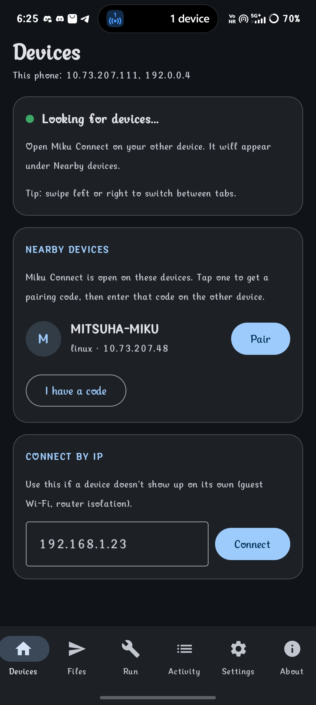
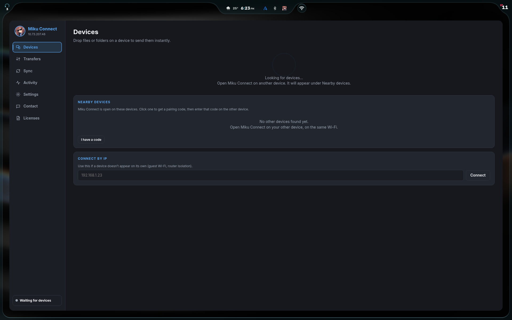
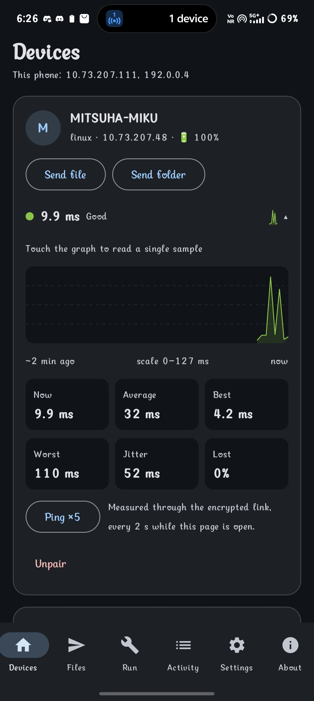
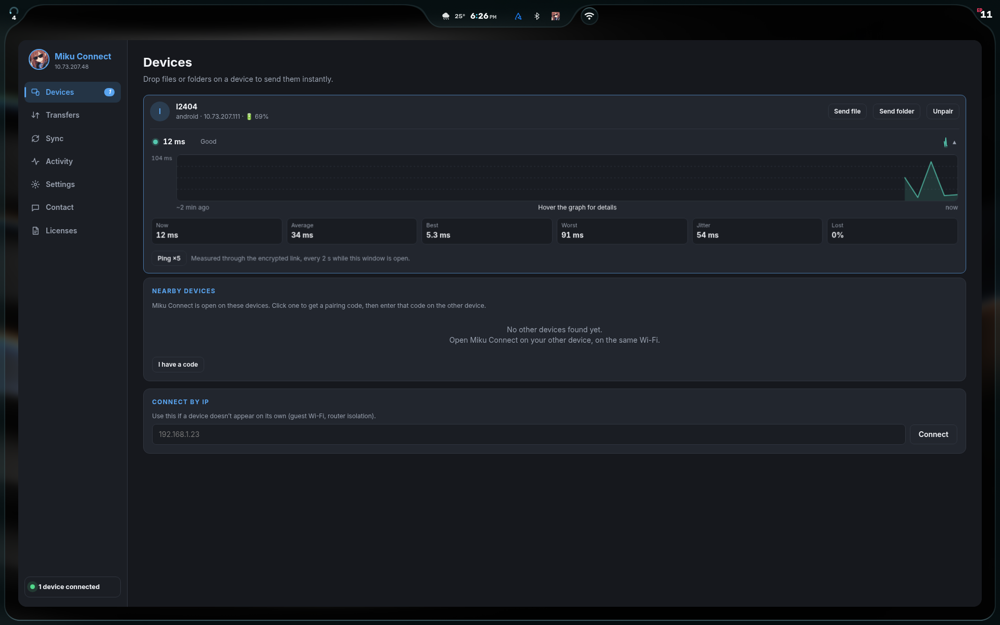
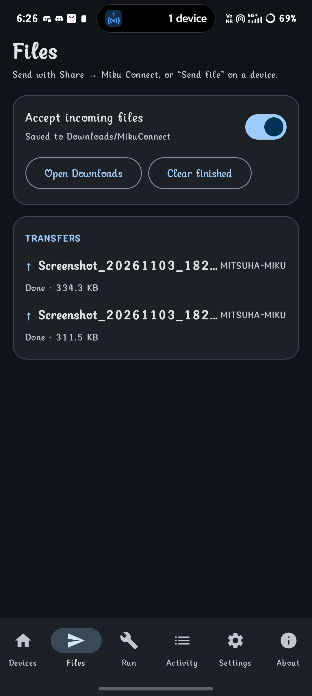
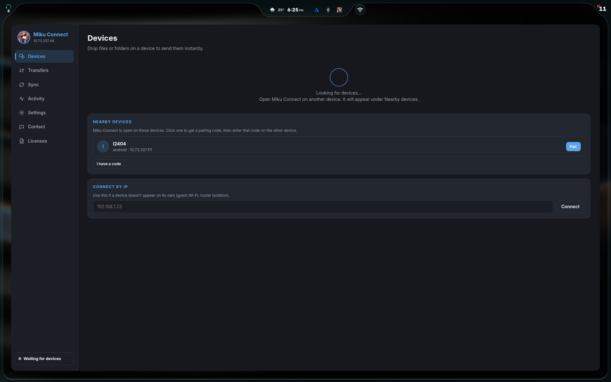

<div align="center">

# Miku Connect

**Keep your Android phone and Linux or Windows computer in sync over your local network. No cloud. No account.**

Notifications · Clipboard · File transfer · Battery status · Remote commands

</div>

## From the Author

Hi, I'm Yokeswaran, an 18-year-old student. I made Miku Connect, inspired by [KDE Connect](https://invent.kde.org/network/kdeconnect-kde). I hope to add more features over time.

If you find an issue, feel free to [contact me](https://discord.com/users/895560596064464956) or [report it on GitHub](https://github.com/Yokeswaran4/Miku-Connect/issues). You can also browse the [source repository](https://github.com/Yokeswaran4/Miku-Connect) or get the latest builds from [Releases](https://github.com/Yokeswaran4/Miku-Connect/releases).

So far, the app has been tested on Android and Arch Linux, using GNOME and niri on Wayland. Starting with future releases, I plan to test on Arch Linux rolling, Windows 11, Android 16, and Debian 13 as well.

The name, icon, and other branding are temporary. I plan to refresh them and publish the updated branding within the next three releases.

## Releases

Get the latest Android and desktop builds from **[Miku Connect Releases](https://github.com/Yokeswaran4/Miku-Connect/releases)**. Read the [v1.0 release notes](RELEASE_NOTES_v1.0.md) for build details, setup steps, and checksums. For builds from source, see [Building the desktop app](#building-the-desktop-app) and [Building the Android app](#building-the-android-app).

## Table of contents

1. [Overview](#overview)
2. [Features](#features)
3. [Screenshots](#screenshots)
4. [Building the desktop app](#building-the-desktop-app)
5. [Building the Android app](#building-the-android-app)
6. [Pairing your devices](#pairing-your-devices)
7. [Android one-time setup](#android-one-time-setup)
8. [Using the app](#using-the-app)
9. [File transfer](#file-transfer)
10. [Battery and connection latency](#battery-and-connection-latency)
11. [Remote commands](#remote-commands)
12. [Security and privacy](#security-and-privacy)
13. [Network and firewall](#network-and-firewall)
14. [Protocol reference](#protocol-reference)
15. [Settings and configuration](#settings-and-configuration)
16. [Troubleshooting](#troubleshooting)
17. [Theming](#theming)
18. [Project structure](#project-structure)
19. [Tech stack and credits](#tech-stack-and-credits)
20. [Made with AI](#made-with-ai)
21. [License](#license)
22. [Contact](#contact)

---

## Overview

Miku Connect links Android phones, Linux computers, and Windows computers on the same Wi-Fi or LAN. Copy text on a computer and paste it on your phone, receive phone notifications on your desktop, or send files and folders between paired devices. Messages and files are encrypted, and they stay on your local network. The project is inspired by [KDE Connect](https://invent.kde.org/network/kdeconnect-kde), an open-source project that connects devices across platforms.

| App | Platforms | Built with |
|---|---|---|
| Desktop | Linux (AppImage), Windows (installer and portable `.exe`) | Electron, Node.js |
| Android | Android 10+ (API 29) | Kotlin, Jetpack Compose, Material 3 |

## Features

| Feature | What it does |
|---|---|
| Clipboard | Sync text between desktop and Android. Desktop-to-phone is automatic; Android-to-desktop can be sent with a tile, notification action, Share menu, or optional automatic mode. |
| Notifications | Mirror Android notifications to connected devices. Linux desktop notifications can also be forwarded when `dbus-monitor` is installed. |
| File transfer | Send files and folders in either direction, with progress, cancellation, collision-safe filenames, and resume after a disconnect. |
| Device discovery | Find devices automatically over UDP, with a Connect by IP option for networks that block discovery. |
| Pairing | Pair devices with a code that is not transmitted over the network. |
| Battery and latency | See connected devices' battery status and encrypted-link latency. |
| Remote commands | Run commands from Android on a paired Linux or Windows computer. This is off by default. |
| Privacy | No cloud service, relay, or account is required. |

## Screenshots

The sample screenshots below are already included in the repository under [`assets/`](assets/).

<details>
<summary>Show Android and desktop screenshots</summary>

| Android | Desktop |
|---|---|
|  |  |
|  |  |
|  |  |

</details>

## Building the desktop app

Requires Node.js **20 or newer** and npm.

```bash
cd desktop
npm install
npm start
```

Build a distributable on its target operating system:

```bash
npm run dist:linux  # Build the Linux AppImage on Linux
npm run dist:win    # Build the Windows installer and portable .exe on Windows
```

Build outputs are written to `desktop/dist/`:

- Linux: `Miku-Connect-Mitsuha_Miku_v1.AppImage`
- Windows: `Miku-Connect-Setup-Mitsuha_Miku_v1.exe` and `Miku-Connect-Portable-Mitsuha_Miku_v1.exe`

To run the AppImage:

```bash
chmod +x Miku-Connect-Mitsuha_Miku_v1.AppImage
./Miku-Connect-Mitsuha_Miku_v1.AppImage
```

Run the desktop transfer tests with:

```bash
cd desktop
npm test
```

Closing the desktop window hides it in the system tray; choose **Quit** from the tray menu to stop the app.

## Building the Android app

1. Open the `android/` directory in Android Studio (Ladybug or newer) and allow Gradle to sync.
2. Connect an Android phone and press **Run**, or choose **Build → Build APK(s)**.
3. To build from a terminal, run `gradle wrapper` once in `android/` if the Gradle wrapper is not available, then run:

   ```bash
   cd android
   ./gradlew assembleDebug
   ```

The app requires Android 10 or newer (API 29). A JDK 17 Android build environment is recommended.

## Pairing your devices

1. Connect all devices to the **same Wi-Fi/LAN** and open Miku Connect on each.
2. Open **Devices**. Other Miku Connect devices on the network appear under **Nearby devices**.
3. Select the device you want to pair with. This device displays a pairing code, and the other device asks you to enter it.
4. Enter the displayed code on the other device and press **Pair**.

If you miss the pairing prompt, choose **I have a code** under Nearby devices or enter the code in **Settings**. The pairing code is never sent over the network; only a request to ask for the code is sent. Entering a new code replaces the current one, so use the same code on every device you want to connect.

To disconnect a device and stop it reconnecting, select **Unpair** on its device card. The device will appear under Nearby devices again and can be paired later.

If automatic discovery does not work (for example, on guest Wi-Fi or a network with access-point isolation), use **Connect by IP**.

## Android one-time setup

- **Notification access:** Select **Grant notification access** in the app and enable Miku Connect. On Android 13+ with a sideloaded app, you may first need **Settings → Apps → Miku Connect → ⋮ → Allow restricted settings**.
- **Battery:** Set Miku Connect to **Unrestricted** using the in-app button so Android is less likely to stop the background connection.
- **Notifications:** Allow notifications when prompted. They are used for the background service and for displaying notifications from other devices.
- **Clipboard tile (optional):** Add the **Send clipboard** tile using the Quick Settings edit menu.
- **Automatic clipboard sending (optional):** Enable **Settings → Sync → Send clipboard automatically** and grant **Display over other apps** permission when prompted.

## Using the app

### Desktop tabs

| Tab | What it does |
|---|---|
| **Devices** | Connected and nearby devices, battery and latency details, and Connect by IP. Send files or folders from a connected device card; drag and drop files onto a device. |
| **Transfers** | View active and completed file transfers. |
| **Sync** | Configure clipboard, notifications, battery sharing, incoming files, and remote control. |
| **Activity** | Review recent connection, notification, clipboard, and error events. |
| **Settings** | Configure theme, startup behavior, device name, pairing code, and other device options. |
| **Contact / Licenses** | Contact links, project licenses, and third-party notices. |

### Android tabs

The Android app provides **Devices**, **Files**, **Run**, **Activity**, **Settings**, and **About**.

### Clipboard

| Direction | Behavior |
|---|---|
| Desktop → Android | Text is copied to the phone automatically when clipboard sync is enabled. |
| Android → desktop | Use the Send clipboard tile, the persistent notification action, **Share → Miku Connect**, or **Send clipboard now** in Settings. Optional automatic sending is available in **Settings → Sync**. |

Android 10 and newer restrict background clipboard reads. Optional automatic sending uses **Display over other apps** to briefly open an invisible foreground activity to read and send the changed clipboard text. Some phone manufacturers restrict background activity starts further; if automatic sending does not work, use one of the manual options above. Clipboard sync supports text up to 1 MB.

### Notifications

- Android notifications are mirrored to connected devices when notification access is granted.
- Linux desktop notifications can be forwarded when `dbus-monitor` is installed.
- Windows desktop notifications are not forwarded to other devices.
- The desktop app can send a test notification to check the connection.

## File transfer

File transfer works in every direction (Android ⇄ desktop and desktop ⇄ desktop) and supports any file type. Files are encrypted with the pairing-code key and sent directly over the LAN.

| Sender | How to send |
|---|---|
| Desktop | Choose **Send file** or **Send folder** on a connected device, or drag and drop files or folders onto that device's row. |
| Android | Choose **Send file** or **Send folder** under a connected device, or use **Share → Miku Connect** from another app. |

Received files are saved in `Downloads/MikuConnect/` on desktop and Android. Existing files are not overwritten; a name such as `photo.jpg` becomes `photo (1).jpg` if it already exists.

Folders and their subfolders are recreated at the destination. Symbolic links and empty folders are skipped. The **Accept incoming files** switch lets a device decline incoming transfers.

If a connection drops during a transfer, the received part is kept and the sender can continue automatically when the device reconnects, or you can press **Resume**. Resume uses the same unchanged file; cancelling removes its partial transfer. Unfinished partial files are deleted after 7 days.

## Battery and connection latency

Connected devices share battery level and charging state, shown on their device cards (for example, `🔋 85%` or `⚡ 40%`). Phones report changes as they happen; laptops are checked about once a minute. Desktop computers without batteries report no battery status. Battery sharing can be disabled under **Sync**.

Latency is measured over the encrypted connection. The app displays current and historical measurements, including average, best, worst, jitter, and packet loss. It can be disabled with the device's latency controls.

## Remote commands

The Android **Run** tab can run a command on a paired Linux or Windows computer and show its output. Remote commands are **off by default**; enable **Sync → Remote control from your phone → Allow commands from phone** on the computer to use them.

- Commands run as the normal user, never elevated, with stdin closed and a selectable timeout (30, 60, or 120 seconds). Output is capped at 48 KB.
- Requests are accepted only from a paired Android device and appear in **Activity** on the computer.
- Delete commands (including `rm`, `del`, `Remove-Item`, and similar commands) and common elevation commands are refused.
- Saved and recent commands are stored on the phone.

The delete and elevation checks are guard rails, **not a security sandbox**. A determined command can still change files in other ways. Keep remote control off when it is not needed.

## Security and privacy

- WebSocket messages and file-transfer data are encrypted with AES-256-GCM. The encryption key is derived from the pairing code using PBKDF2-SHA256.
- Pairing codes are not broadcast or transmitted as part of the pairing request. Devices using a different code cannot authenticate encrypted messages.
- Device discovery uses UDP broadcast, and data connections are made directly between devices. The app does not require a cloud service, relay, or account.
- Received file paths are sanitized, files are not overwritten, and data beyond the announced file size is rejected.
- Debug reports omit clipboard text, notification text, IP addresses, serial numbers, and the pairing code.

Pair only with devices you trust and use a strong, non-obvious pairing code if you set one yourself. Anyone on the local network who knows the code can communicate with your devices.

## Network and firewall

| Port | Protocol | Purpose |
|---|---|---|
| **48998** | TCP | Encrypted WebSocket connections |
| **48999** | UDP | Device discovery and pairing requests |

- **Windows:** accept the firewall prompt on first launch and allow access on private networks.
- **Linux with ufw:**

  ```bash
  sudo ufw allow 48998/tcp
  sudo ufw allow 48999/udp
  ```

Guest networks and routers with client/AP isolation may block device-to-device traffic. Use a network that permits local communication or connect by IP.

## Protocol reference

Devices discover one another with UDP broadcasts on port 48999 every 3 seconds. A beacon contains the app identifier, device ID, name, platform, and WebSocket port. Pairing requests are sent directly by UDP and do not contain the pairing code.

The encrypted transport uses WebSocket on TCP port 48998. Each text frame contains base64-encoded `iv[12] + ciphertext + tag[16]` for a JSON message. The key is derived using `PBKDF2-SHA256(UPPERCASE(code without symbols), "miku-connect-v1", 100000 iterations, 32 bytes)`.

| Message | Fields / purpose |
|---|---|
| `hello` | `id, name, platform` |
| `clipboard` | `text` |
| `notification` | `app, title, text` |
| `battery` | `level, charging` |
| `unpair` | Mark the other device as unpaired |
| `ping` / `pong` | Measure encrypted-link latency |
| `cmd-run` / `cmd-cancel` / `cmd-result` | Remote command requests and results |
| `file-offer` / `file-accept` / `file-reject` | Negotiate a file transfer |
| Binary frames / `file-end` / `file-ack` | Transfer encrypted chunks and finish or acknowledge a file |
| `file-cancel` | Cancel a transfer |

File data is sent in encrypted binary frames containing a transfer ID and up to 64 KiB of data. Optional transfer identifiers and offsets support resuming interrupted files. Receivers sanitize each path component and reject data beyond the announced size.

## Settings and configuration

Desktop settings are stored in `config.json` in Electron's user-data directory. Common options include:

| Setting | Default | Purpose |
|---|---|---|
| Device ID | Random UUID | Identifies this device |
| Device name | Operating-system hostname | Name shown to other devices |
| Pairing code | Randomly generated | Shared encryption secret |
| Clipboard sync | On | Enable clipboard synchronization |
| Notification sync | On | Send and show notifications |
| Battery sharing | On | Share battery status |
| Accept incoming files | On | Receive or decline file transfers |
| Allow commands | Off | Allow paired Android devices to run commands |
| Launch on startup | Off | Start the desktop app at login |
| Theme | System | Follow system, light, or dark appearance |

## Troubleshooting

<details>
<summary>Devices do not appear or connect</summary>

- Confirm all devices are on the same Wi-Fi/LAN and Miku Connect is open.
- Check that TCP **48998** and UDP **48999** are allowed through the firewall.
- Guest Wi-Fi and AP/client isolation can block device discovery or connections. Try **Connect by IP** on a network that permits local traffic.
- If pairing was missed, choose **I have a code** and enter the code shown on the other device.
- Re-enter the same pairing code on both devices if they connect but do not sync.

</details>

<details>
<summary>Android notifications or background connection do not work</summary>

- Grant notification access to Miku Connect.
- On Android 13+ with a sideloaded app, allow restricted settings if Android requires it.
- Set Miku Connect's battery usage to **Unrestricted** and allow notifications for the background service.

</details>

<details>
<summary>Clipboard sync or file transfer does not work</summary>

- For Android-to-desktop clipboard sending, use the tile, persistent notification action, Share menu, or enable automatic sending and grant its overlay permission.
- If automatic clipboard sending is blocked by the phone, use one of the manual send options.
- If a file transfer is interrupted, reconnect the devices and use **Resume** or send the same unchanged file again.
- A file shared from another Android app may need to be selected and shared again if Android has withdrawn access to it.

</details>

<details>
<summary>Desktop notifications or remote commands do not work</summary>

- Linux notification forwarding requires `dbus-monitor` (provided by the `dbus` or `dbus-bin` package).
- Windows does not forward its own desktop notifications.
- Remote commands require **Allow commands from phone** to be enabled on the computer. This setting is off by default.
- For a useful bug report, open **About this device** and copy or save the debug report.

</details>

## Theming

- **Windows and Linux:** follows the operating-system light/dark setting. Windows uses the system accent color when enabled; Linux uses Miku blue.
- **Android:** follows the system light/dark setting. Android 12+ uses Material You colors; Android 10–11 uses a Miku-blue palette.

## Project structure

```text
MikuConnect/
├── assets/       Sample Android and desktop screenshots used in this README
├── desktop/      Electron app for Linux and Windows
└── android/      Android Studio project (Kotlin and Jetpack Compose)
```

The desktop app contains the discovery, pairing, sync, transfer, and remote-command logic, plus its renderer UI. The Android app contains the Compose UI, foreground sync service, notification listener, clipboard integrations, and transfer logic.

## Tech stack and credits

Miku Connect is inspired by [KDE Connect](https://invent.kde.org/network/kdeconnect-kde). Its implementation and protocol are separate; KDE Connect is credited here as a source of inspiration.

The project uses the following open-source software:

| Component | Used for | License |
|---|---|---|
| [Electron](https://github.com/electron/electron) | Desktop app runtime | MIT |
| [Chromium](https://www.chromium.org/) | Web engine included with Electron | BSD-3-Clause and other licenses |
| [Node.js](https://github.com/nodejs/node) | Desktop app runtime | MIT and other licenses |
| [`ws`](https://github.com/websockets/ws) | Desktop WebSocket transport | MIT |
| [electron-builder](https://github.com/electron-userland/electron-builder) | Desktop packaging and builds | MIT |
| [D-Bus `dbus-monitor`](https://www.freedesktop.org/wiki/Software/dbus/) | Optional Linux desktop notification forwarding; system-provided, not bundled | AFL-2.1 or GPL-2.0-or-later |
| [Kotlin](https://github.com/JetBrains/kotlin) and [kotlinx.coroutines](https://github.com/Kotlin/kotlinx.coroutines) | Android app language and asynchronous operations | Apache-2.0 |
| [Jetpack Compose](https://developer.android.com/compose), [Material 3](https://developer.android.com/develop/ui/compose/designsystems/material3), and [Material Icons](https://github.com/google/material-design-icons) | Android user interface | Apache-2.0 |
| [AndroidX Core KTX](https://developer.android.com/jetpack/androidx) | Android platform support | Apache-2.0 |
| [AndroidX Activity Compose](https://developer.android.com/jetpack/androidx/releases/activity) | Android activity integration for Compose | Apache-2.0 |
| [AndroidX Lifecycle](https://developer.android.com/jetpack/androidx/releases/lifecycle) | Android lifecycle support | Apache-2.0 |
| [Java-WebSocket](https://github.com/TooTallNate/Java-WebSocket) | Android WebSocket transport | MIT |
| [Android Open Source Project](https://source.android.com/) | Android platform APIs | Apache-2.0 |
| [Android Gradle Plugin](https://developer.android.com/build) and [Gradle](https://github.com/gradle/gradle) | Android build tools; not included in the app | Apache-2.0 |

These are the direct project dependencies and tools documented for this project; some components, including Chromium and Node.js, also include their own third-party dependencies. See [`THIRD-PARTY-NOTICES.txt`](THIRD-PARTY-NOTICES.txt) and the in-app **Licenses / About** screens for fuller notices and copyright details.

## Made with AI

AI tools have been used as assistants during Miku Connect's development, including helping with coding, documentation, and reviewing implementation ideas. They support the work; they do not replace the author's decisions or responsibility for the project. The author guides the project, reviews changes, and remains responsible for what is released.

## License

Miku Connect is dual-licensed. You may use it under either license, at your option:

- [MIT](LICENSE-MIT)
- [GPL-3.0-or-later](LICENSE-GPL-3.0)

See [`LICENSE`](LICENSE) for the licensing notice. Third-party components remain under their respective licenses.

## Contact

Questions, feedback, or ideas?

- **Discord:** [/home/miku](https://discord.com/users/895560596064464956)
- **Instagram:** [@miku_biggest_glazer](https://instagram.com/miku_biggest_glazer)
